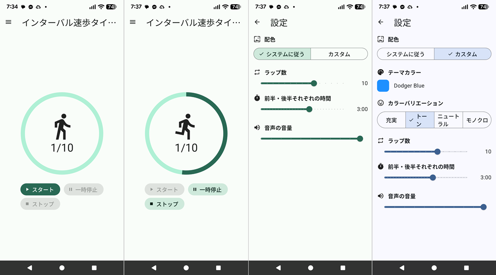

# インターバル速歩タイマー

[English](README.md)

ゆっくり歩く区間と早足で歩く区間を交互に繰り返す、インターバル速歩のための
Android 用タイマーです。状況を画面と音声で知らせます。

## 機能

- 1ラップは前半（ゆっくり歩く）と後半（早足で歩く）に分かれます。初期設定では
  各3分、10ラップで終了します。
- 音声案内:
  - ラップ開始時: ラップ数を2回、続けて「ゆっくり歩いてください」
  - 後半の開始時: 「早足で歩いてください」
  - 前半・後半それぞれの最後の3秒: 3、2、1のカウントダウン
  - 最終ラップの終了後: 終了のメッセージ
- ラップ全体（前半と後半）を円形の進捗インジケーターで表示します。円の中の
  アイコンは、ゆっくり歩く人と早足の人で切り替わり、下にラップ数（`n/10`）を
  表示します。
- スタート、一時停止、ストップのボタンがあります。ストップは確認ダイアログの
  あと、状態をクリアします。
- フォアグラウンドサービスにより、バックグラウンドや画面ロック中もカウントと
  音声案内が続きます。
- 音声案内の間、他アプリの音声は小さくなり、終わると元に戻ります。
- 画面と音声は日本語と英語に対応します。Android の言語が日本語なら日本語、
  それ以外は英語です。
- Android のアプリ名は、日本語環境では「インターバル速歩」、それ以外では
  「Japanese Walking」です。

## 設定

ドロワー（ハンバーガーメニュー）から開きます。

- 配色: システムに従う（壁紙の色）、またはカスタム（テーマカラー）
- カラーバリエーション（カスタムのみ）: 充実、トーン、ニュートラル、モノクロ
- ラップ数（1〜15）と前半・後半それぞれの時間（10秒〜5分）。タイマーの動作中は
  変更できません。
- 音声の音量

## 動作環境

- Flutter 3.32 / Dart 3.8
- Android 7.0（API 24）以降

## ビルドと実行

```sh
flutter pub get
flutter run                          # OSの言語に従う
flutter run --dart-define=LOCALE=en  # デバッグ用に英語（または ja）へ固定
flutter build apk
```

## テスト

```sh
flutter analyze
flutter test
```

## 補足

- 日本語と英語の表示メッセージは `lib/l10n/*.arb` にあります。`flutter gen-l10n` でコードを再生成します。
- Android の `compileSdk`、NDK、`minSdk` は、プラグインの要件に合わせて
  `android/app/build.gradle.kts` で設定しています。
- 他アプリの音量低下やバックグラウンド動作は、端末や相手アプリによって異なります。
  実機で確認してください。

## スクリーンショット

*スクリーンショット*


<br>
*アイコン*

## ライセンス


このプロジェクトは MIT ライセンスの下で公開されています。

詳細は [LICENSE](LICENSE) ファイルを参照してください。